<div align="center">
  
  <h1>未见 · CyberLook</h1>
  <p><em>见你未见 · 照你所患</em></p>
  <p>
    
    
    
    
  </p>
  <p><sub>内网资产测绘与持续维护平台 · 白皮书</sub></p>
</div>

---

## 0. 这份文档想解决什么

大多数"资产扫描系统"交付的是**一次扫描的结果**：导出一张表，人看一眼，然后就过期了。
内网真正难的不是扫一遍，而是回答三个持续存在的问题：

| 问题 | 难在哪 | 未见的答案 |
|---|---|---|
| **这台机器还在吗？** | 一次丢包、一次防火墙抖动，都会被误判为"下线" | 缺席只记账，连续 3 轮才转「睡眠」；每轮命中即回「活跃」。**不删记录** |
| **这台机器上跑的东西变了吗？** | 端口没变、服务换了；页面还是那个 URL、内容改版了 | 页面 SimHash + 标题/响应码/长度四路比对，旧值留档 |
| **这个结论凭什么？** | 报告里写"开放 3306"，三个月后没人能复现 | 每一轮扫描的原始行落本地审计库，单元级可回溯 |

所以这个平台的核心不是"扫描器"，而是**资产的账本**：
扫描是记账的输入，资产表是多轮扫描叠加后的最小共识，处置与合规是账本的用途。
下面按一台主机走完一遍的路径来讲。

---

## 1. 一台主机的全生命周期

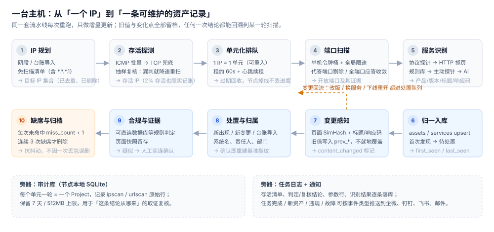

十个环节，每一步只做一件事，且都能单独重跑：

| # | 环节 | 输入 | 输出 | 失败/边界怎么处理 |
|---|---|---|---|---|
| 1 | **IP 规划** | 网段、台账、手工 IP | 去重、去免扫描后的目标 IP 集合 | 免扫描支持 `198.18.5.10-20`、`198.18.5.0/24`、`*.*.*.1`；内置一条"每个网段的 .1" |
| 2 | **存活探测** | 目标 IP 集合 | 存活 IP（极少时也照实记账） | ICMP 批量 + TCP 16 端口兜底；抽 2% 判死主机低速复核，发现漏判就降并发重扫 |
| 3 | **单元化排队** | 存活 IP 列表 | 每个 IP 一条 `task_units` | 1 IP = 1 单元，租约 60s，节点掉线自动回收重派，最多 3 次 |
| 4 | **端口扫描** | 单元 + 端口集 | 开放端口 + 证据 | 单机令牌桶 300 pps、全局限速；被中间设备代答的端口剔除；全端口应答设备收敛 |
| 5 | **服务识别** | 开放端口 | 产品/版本/标题/响应码/页面指纹 | 四级递进，拿不到就降级为裸 `tcp`，绝不编产品名 |
| 6 | **归一入库** | 识别结果 | `assets` + `services` 增量更新 | 幂等 upsert；首见归本轮任务，之后只更新 `last_task_id` |
| 7 | **变更感知** | 本轮 vs 上轮 | `prev_*` 旧值、`content_changed` | 与**确认时的基准**比，不是与台账标题比 |
| 8 | **处置与归属** | 待处置队列 | 系统名/责任人/部门 | 新出现、新变更、台账导入三类入口；确认即重建基准 |
| 9 | **合规与证据** | 服务记录 | 疑似/违规标记、页面快照 | 扫描期只做数据比对标记，实连确认由人一键触发 |
| 10 | **缺席与结算** | 本轮未命中的服务 | `miss_count`，连续 3 轮转 `sleeping` | 抗抖动：一次没扫到不等于服务消失；只改状态不删行，避免重扫又变「新发现」 |

配套两条旁路（不影响主链路，可独立关闭）：

- **审计库**：节点本地 SQLite（WAL），每个单元一轮一个 Project，保留 7 天 / 512MB；
- **任务日志 + 通知**：存活清单、判定与复核结论、参数行、识别结果逐条落库，并可按事件推送到企业微信/钉钉/飞书/邮件。

---

## 2. 单条服务的状态演进

资产的"动态"落到最后，是一条 `ip:port` 记录在几个状态之间移动：

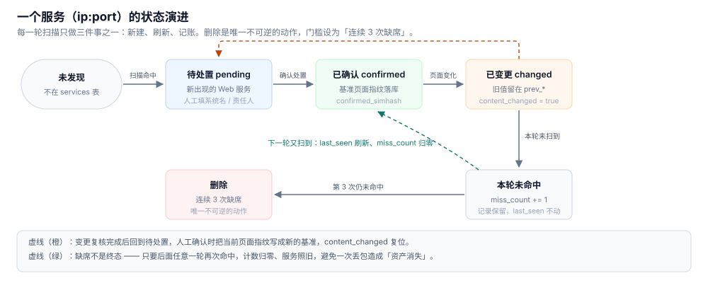

三条规则决定了它不会乱跳：

1. **命中即刷新**：任一轮扫到该端口 → `last_seen` 刷新、`miss_count` 归零。
   表达现状用"最近一次看见"，而不是"曾经看见过"。
2. **缺席不删记录**：未命中只累加 `miss_count`，连续 3 轮转 `sleeping`，重新扫到立刻回 `active`。
   一次超时、一次防火墙限速、一次节点被限流，都不该让资产消失；而删了行，下轮重扫又会变成「新发现」。
   计数单位是**这个 IP 被扫描的轮次**：领取失败/被隔离的单元不算一轮，同一任务重复收尾不双计。
3. **新旧并存**：变更时旧值写入 `prev_title` / `prev_fingerprint` / `prev_status_code` / `prev_content_length`，
   当前值照常前进。处置页面展示的是"旧 → 新"，不是覆盖后的既成事实。

> 主机级与端口级是两个粒度：`assets.status` 只有 `pending` / `confirmed`；
> 增删与变更发生在 `services`。同一台已确认的主机新冒出一个 Web 服务，会被拉回待处置。

---

## 3. 数据模型：扫描是过程，资产是结果

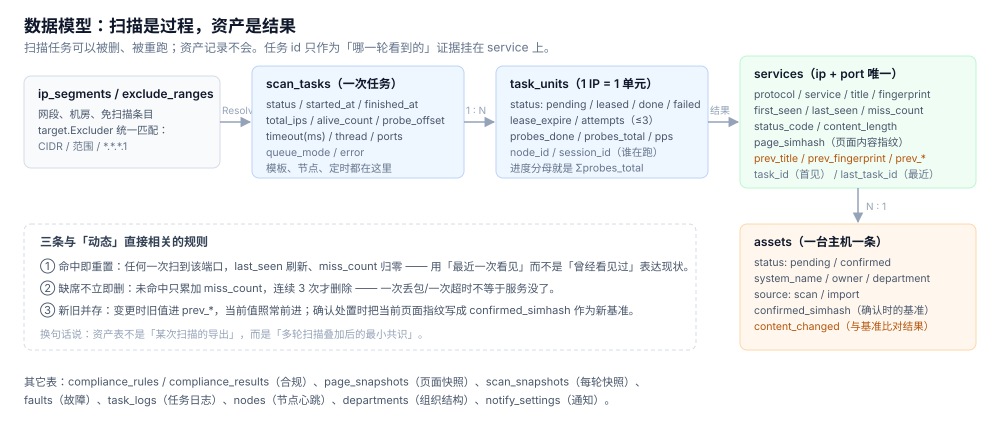

关键字段与其职责：

| 表 | 关键字段 | 说明 |
|---|---|---|
| `scan_tasks` | `status` / `total_ips` / `alive_count` / `probe_offset` / `timeout`(ms) | 一次任务；可删除、可重跑，**不承载资产事实** |
| `task_units` | `status` / `lease_expire` / `attempts` / `probes_done` / `probes_total` | 1 IP = 1 单元，进度分母 = Σ`probes_total` |
| `services` | `first_seen` / `last_seen` / `miss_count` / `page_simhash` / `prev_*` | 端口级事实，`(ip, port)` 唯一 |
| `assets` | `status` / `source` / `system_name` / `owner` / `confirmed_simhash` / `content_changed` | 主机级事实，一台一条 |
| `compliance_*` | 规则与结果 | 可直连数据库等违规的判定与确认记录 |
| `page_snapshots` | 页面截图与哈希 | Web 资产的可视证据 |

`services.task_id` 记"首次发现归属哪一轮"，`last_task_id` 记"最近一次看到"。
两个字段分开，任务被删也不会让资产失去出处。

---

## 4. 执行面：调度在中心，判定在节点，证据在本地

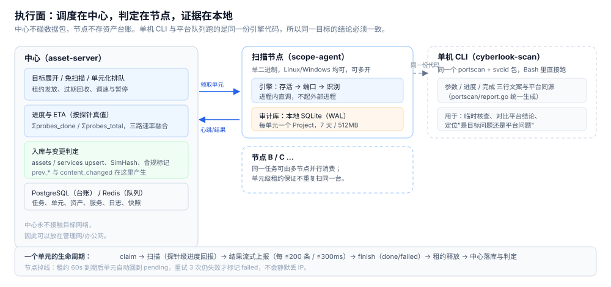

- **中心不碰数据包**：目标展开、单元化、租约发放、进度与 ETA、入库与变更判定全在 server 侧；
  因此 server 可以放在管理网，只有节点需要能到达目标网段。
- **节点不存台账**：`scope-agent` 是单二进制（Linux/Windows），进程内直调引擎，不起外部进程；
  本地只保留审计库。
- **单机 CLI 与平台同一份代码**：`portscan` + `svcid` 两个包，`cyberlook-scan` 直接编译可用；
  参数行/进度行/完成行由同一套格式化函数生成 —— 同一个目标在两边给出不同结论，就是 bug。

### 4.1 单元调度

`claim → 扫描 → 流式上报 → finish → 释放`。结果按"每 ≤200 条或 ≤300ms"批量上报；
掉线后租约 60s 到期，单元回到 `pending`，重试 3 次仍失败才标 `failed` —— 不静默丢 IP。

### 4.2 配速与假阴性

吞吐的唯一决定因素是"在途探针数"，但它有三堵墙：fd、CPU、内存。
节点自己闭环调节（每 10s 看 EMFILE 计数、自身 CPU 时间、本窗口实际探针数），
在 `[base/4, base]` 内移动；人工下发的 `limit/pause` 优先，不被自动逻辑推翻。

单目标另设 300 pps 的令牌桶：常见防火墙对**同一目的 IP** 的 SYN 限速在 100~1000 pps，
超了就是静默丢包 → 开着的端口被判成关闭（假阴性）。300 pps 下扫完一台 65535 端口约 3.5 分钟。

存活探测同样有复核机制：抽 2% 判死主机以 1/8 速率重探，只要发现漏判就整体降并发重扫。

### 4.3 两类"看起来开放"的假阳性

| 现象 | 判定方式 | 处理 |
|---|---|---|
| 80/443 对**任意地址**都回 SYN-ACK（中间设备代答） | 对 RFC5737 保留地址 `192.0.2.1` / `198.51.100.1` 探同一批端口 | 该端口从判活集合中剔除，任务日志写明"被中间设备代答" |
| 单台主机"开放"上万个端口（SYN 代理 / 全端口转发 / 蜜罐） | 单 IP 开放数超过 256（端口集 ≥1024 时生效） | 判定为全端口应答设备，停止该主机的识别与入库，保留前 256 个并记日志 |

后者来自实测：一台这样的设备曾产出 12,905 条伪服务记录（占整库 98%），
把 32 并发的识别池打满、CPU 打到 97%，同节点另外 6 个单元被拖到重试耗尽。

---

## 5. 服务识别工作流

识别是**分级递进**的，每一级失败才进下一级，全部失败就老老实实记 `tcp`：

```
① 协议探针（被动优先）    banner / 握手 → SSH、SMB、MySQL、Redis、RDP…
② Windows 主动握手        445/139/3389/135 上取真实 OS 与主机名
③ HTTP 抓页               标题、状态码、favicon 双哈希、TLS 证书 CN/O
④ 规则匹配                web 3450 条 + service 11938 条（FingerprintHub, MIT）
⑤ 主动探针                被动拿不到 banner 时按端口发对应载荷（每端口 ≤3 组）
⑥ AI 兜底                 标题为空/默认页/纯 IP 时异步走「抓完整请求响应包 → AI → 渲染 → AI 再判」
```

识别链路的"是不是这个系统"**只由模型判断**，不做产品名/标题的正则裁决
（正则永远调不完：白名单外的真系统被误杀、新默认页一出现就得补规则）。
代码里只保留两类非判断逻辑：GBK/GB2312 转码（编码问题不是判断问题）、空值与单字符拦截。

渲染这一级共用一个常驻浏览器实例：全进程 1 个 chromium，CDP 开标签页渲染，
连续 5 分钟没有任务就把实例连同 profile 一起销毁（实测单实例 VmRSS ≈ 218MB，
旧实现每次渲染 spawn 一个进程、3 并发约 600MB，且被 kill 时 `/tmp` 里会留 profile 目录）。
可调：`CHROME_IDLE_SEC`（空闲秒数）、`CHROME_MAX_TABS`（并发标签页，默认 2）、`CHROME_PROFILE_DIR`。

**喂给模型的证据必须是完整的**（v0.0.48）：请求行/请求头/响应行/响应头全量，响应体抓到 32KB
（旧实现只读 3000 字符，再截到 1500 字交给模型——SPA 首页的产品名往往在截断点之后）。
同一份完整报文同时写进会话记录，界面上折叠成「原始请求 / 响应」块，人也能逐字节复核。
另外 GBK/GB2312 页面会被整段转成 UTF-8 再判：旧逻辑遇到 `utf8.Valid=false` 直接当"二进制内容"
丢弃 body，中文标题一个字都拿不到——这是内网老系统识别不准的主因之一。

**抓页这一级有三个「看起来很正常的空页面」，都会让模型判成未知**（v0.0.49 全部修掉）：

| 现象 | 真实原因 | 处理 |
|---|---|---|
| 抓到的页面只有 `Redirection……` | 设备返回 200 + `<script>location.replace('https:'+…)</script>`，是**页面内 JS 跳转**，不是 3xx | 解析 meta refresh 与 `location.replace/href`，连同 `location: ./login` 这类相对地址一起跟（跨主机不跟） |
| https 侧完全抓不到 | Go 1.22 起默认不再提供静态 RSA 套件，老设备（超融合、老 VPN）只支持它，握手直接失败 | 单独一套 legacy TLS 配置补回 RSA 套件与 TLS1.0 |
| 渲染回来正文是空的 | 固定 sleep 600ms，Vue 登录页此时还没有一个字 | 轮询 `body.innerText` 长度，有内容且稳定即返回 |

判定上还有两条：**置信度 <80 必须继续渲染**（"深信服"是厂商级，"深信服超融合平台"才是产品级）；
**壳页标题一律不落库**（`Redirection……`、`HTTP`、`307 TEMPORARY REDIRECT`、空、默认页），
并且不覆盖已有的有效标题——错误标题一旦写进去，下轮会因为"已有标题"而不再复核，错误就被固化了。

口径上有几条刻意的克制：
- **单一弱词命中不算产品**（`score < 15` 不并入技术栈），避免一个页面报出四个产品；
- **多技术栈最多并列 3 个**，顺序即置信度；
- **占位产品名清空**：`UnKnown`、`ssl`、`tcp` 这类值不写库、不上终端；
- **"识别 N 个"只统计真的拿到产品/标题的端口**，进过识别池不算。

---

## 6. 指标口径

| 指标 | 口径 | 为什么这样定 |
|---|---|---|
| 进度 | `Σprobes_done / Σprobes_total` | 按 IP 计会让几万 IP 的任务长时间停在 0%，且单 IP 全端口单元的权重是 top100 的 655 倍 |
| 速率 | 短期 EWMA(10s, α=0.3) 与全程平均加权（0.65 : 0.35）；无样本时用理论初值 | 单一路径要么不跟手，要么被锯齿带跑 |
| ETA | 剩余探针 ÷ 融合速率；样本 <3 标低置信，前端显示"估算中…" | 宁可说不知道，不给会自我打脸的数字 |
| 存活探测 ETA | 只用 TCP 阶段稳态速率（>500 IP/秒的 ICMP 爆发窗口丢弃） | 旧算法把"两秒推完一半"当成速率，94k IP 显示"剩余 2 秒"，实际 7 分 36 秒 |
| 识别率 | 有指纹/标题的端口 ÷ 已处理端口 | 与"进过识别池"区分，后者会虚高 |
| 活跃 / 睡眠 | 按该 IP 被扫描的**轮次**计数，连续 3 轮未命中转睡眠 | 按任务数计会被"失败单元""重复收尾"污染，没扫过也判睡眠 |

---

## 7. 界面一览

> 以下截图使用 **RFC5737 文档地址**（`192.0.2.0/24`、`198.51.100.0/24`）与虚构的系统名/责任人，
> 由真实程序渲染，不含任何真实内网信息。

**首页**：一眼看清「有多少资产、多少待确认、多少违规、有没有任务在跑」，以及最近 7 天的态势曲线。

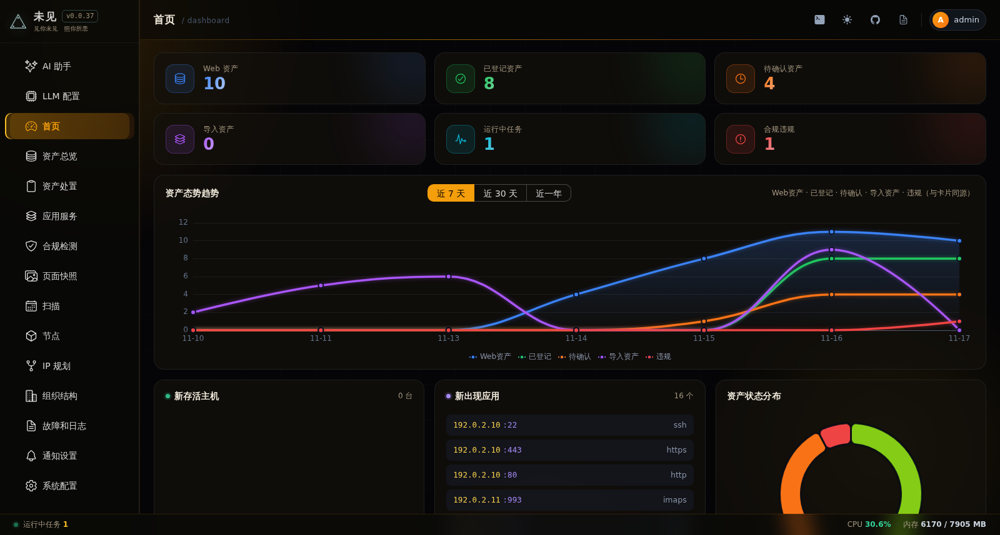

**应用服务**：端口级事实。同一台主机的多个 Web 入口、各自的响应码与指纹、归属的系统名与责任人，
以及「最近发现」时间 —— 这一列就是 `last_seen` 的直接体现。

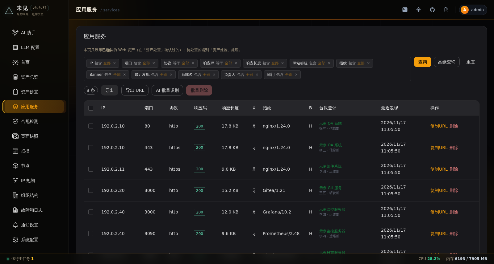

**资产总览**：主机级事实。`状态` 列区分已确认/待确认，`来源` 列区分扫描发现与台账导入。

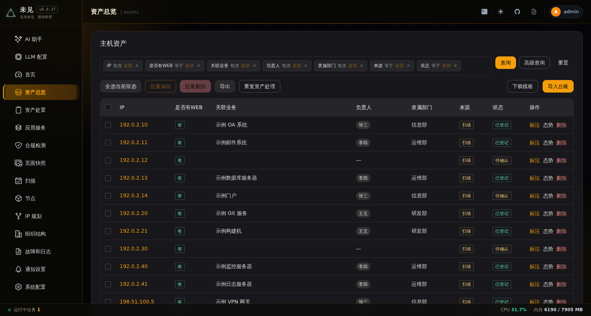

**资产处置**：`主机新出现 / 端口新出现 / 新变更` 三类排队，确认粒度精确到端口；
顶部可按「台账登记：全部 / 空 / 不为空」过滤，确认动作会把当前页面指纹写成新的基准。

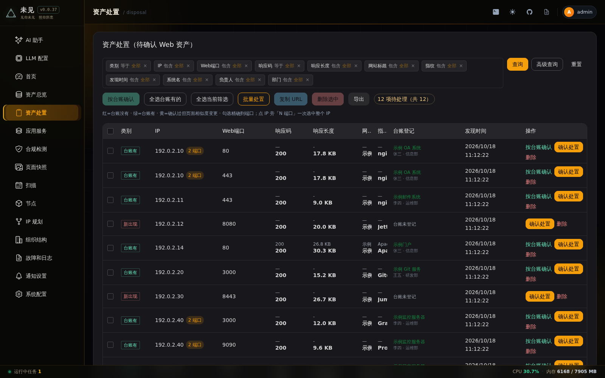

> 截图拍摄于 0.0.37。0.0.49 起列表做了信息密度收敛：资产总览与合规检测的「系统 / 负责人 / 部门」
> 合并为「归属信息」一列，应用服务把「端口 / 协议 / 响应码 / 响应长度」合并为一列并去掉重复的 Banner 列，
> 行内操作列统一移到工具栏。检索与导出字段不变。

**扫描**：任务级视图。存活数、已扫单元、探针进度、ETA 与实时日志（存活清单、判定/复核结论、逐单元识别结果）。

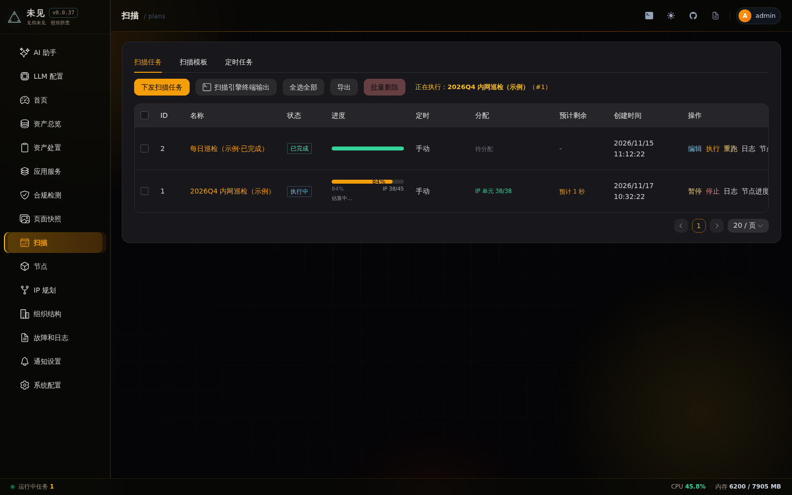

**IP 规划**：网段与免扫描清单。内置的 `*.*.*.1` 就是"每个网段的网关/交换机不进队列"。

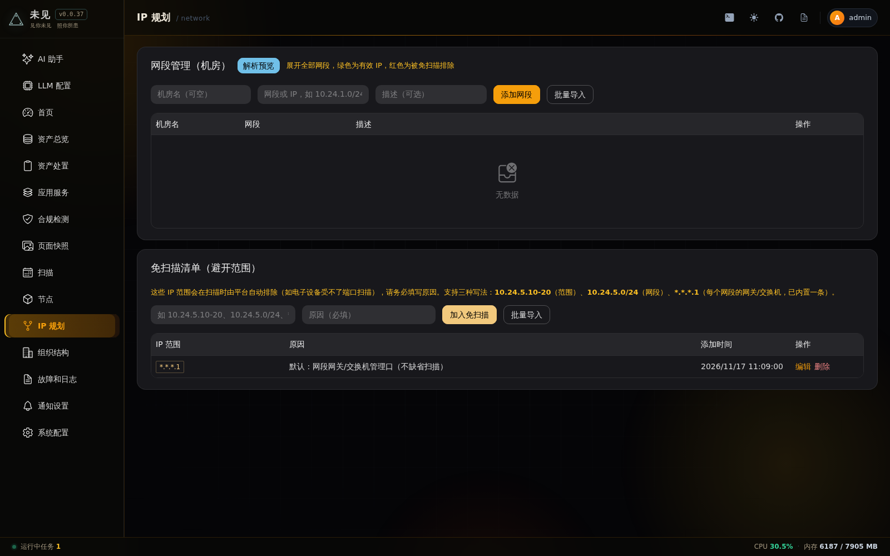

**节点**：每个节点的版本、心跳、并发与链路自检结论（是否被中间设备代答）。

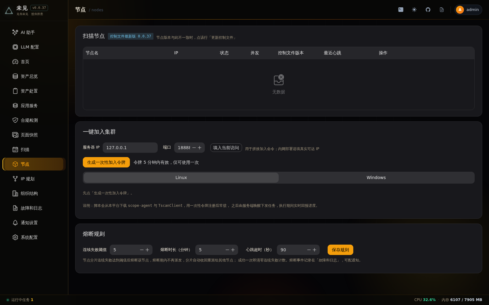

---

## 8. 快速开始

```bash
git clone https://github.com/RongSec/CyberLook.git
cd CyberLook
bash init.sh                 # 生成 .env（随机数据库密码）并拉取最新 release
docker compose up -d         # server + postgres + redis + updater + 一个内置节点
```

- 控制台：`http://<server>:18888`（首次登录 `admin / admin123`，请立即改密）
- 节点加入：在「节点」页复制一键脚本；也可 `docker run`，或裸机运行
  `scope-agent -server http://<server>:18888 -name <节点名>`
- 从源码构建：`docker build --build-arg VERSION=0.0.37 -t ghcr.io/rongsec/cyberlook:0.0.37 .`
- 更新：`updater` 边车负责拉镜像与切版本，主应用不直接持有 `docker.sock`

关键目录：

```
cmd/server|agent|updater      三个入口（中心 / 节点 / 更新边车）
internal/target               目标展开与免扫描匹配（Excluder）
internal/scanner              引擎封装：流式扫描、识别池、审计库、进度解析
internal/service              调度、队列、ETA、入库、合规、通知
internal/api                  HTTP 接口
web/                          Vue3 + Naive UI 前端
migrations/                   PostgreSQL 迁移（按文件名顺序执行，幂等）
data/fingerprint/             全量指纹规则（随镜像内置）
```

---

## 9. 运维要点

- **迁移**：启动时按文件名顺序执行 `migrations/*.sql`，单条失败不影响后续；升级不回滚数据结构。
- **备份**：`pg_dump` 即可完整还原台账；`data/files` 存放页面快照与 JWT 密钥，需一并备份。
- **审计库**：节点本地 `config/config.db`，按保留期（默认 7 天）与容量（512MB）滚动清理，在途会话不受影响。
- **通知**：任务完成 / 新资产 / 违规 / 故障 四类事件分别开关，支持企微、钉钉、飞书、通用 Webhook、邮件。
- **多节点**：同一任务可由多节点并行消费，单元级租约保证不重复扫同一台机器。

---

## 10. 边界与已知限制

- **只做 connect 扫描**：不发半开 SYN、不做协议漏洞利用；对"回 RST 但被中间设备改写"的场景仍需人工复核。
- **全端口任务的时间成本是物理量级**：65535 端口 × 数千台，在单机 300 pps 下就是数小时到数天，配速调不动物理上限。
- **识别依赖规则库**：规则未覆盖的自研系统只能拿到标题或 TLS 证书线索，此时会标记 `title_source`。
- **不做凭据登录与内网横向**：平台止步于"资产是什么"，不做"资产能做什么"。
- **免扫描通配是四段匹配**：`*.*.*.1` 覆盖每网段 .1，不覆盖 `.254`、`.0` 之类习惯差异，需要就自己加。

---

## 11. 致谢与许可

- 早期扫描能力来自 [TideSec/TscanPlus](https://github.com/TideSec/TscanPlus)；v0.0.27 起**已彻底移除**其执行链与二进制分发，仅保留致谢。
- 现引擎为本仓库自研（`portscan` + `svcid`，纯 Go、CGO-free）。
- 指纹规则来自 FingerprintHub（MIT），许可见 `THIRD_PARTY_NOTICES.md`。

本项目无一行人类代码，将来也不会使用一行人类代码；但所有功能均经过人类验证。
测试环境：麒麟 / Ubuntu / Windows；测试目标：真实企业内网 94,653 个 IP。
