<div align="center">
  
  <h1>未见</h1>
  <p><em>见你未见 · 照你所患</em></p>
  <p>
    
    
    
    
  </p>
</div>

未见是一个企业内网资产发现、合规检测与处置管理平台。致力于基于事实发现的内网资产动态维护。

**核心能力**：分布式端口/Web 扫描 → 存活探测 → 资产处置 → 组织归属 → 合规检测 → 变更感知
## 
本项目无一行人类代码，将来也不会使用一行人类代码。但所有功能均经过人类验证。0.0.2版本为功能完善的第一次发版，目前已进入长期维护阶段。

测试环境：麒麟，ubuntu,windows。

测试目标：真实企业内网共94653个IP

## 特别鸣谢
- https://github.com/TideSec/TscanPlus —— 早期版本的扫描能力来源，v0.0.27 起已**彻底移除**（`TscanClient` 执行链、`tscan-binary` 分发路由全部删除），仅在此保留致谢。
- 现扫描引擎为仓库内自研（`internal/portscan` + `internal/svcid`，纯 Go、CGO-free），规则数据来自 FingerprintHub（MIT）。

## TODO
- 暂停在继续后扫描任务的概览会重复一次分片计数（不影响功能和数据）
## 功能特性

- **资产发现**：自研引擎（`internal/portscan` connect 扫描 + `internal/svcid` 全量指纹识别）做端口扫描与 Web 指纹识别
- **分布式扫描**：多节点（支持 Windows/Linux）批量调度，可对节点单独设置参数，灵活分片，敏捷调度
- **资产处置**：按分类处置资产（新出现 / 新变更 / 台账导入）
- **SimHash 内容变更检测**：基于页面内容指纹判断资产是否改版，避免重复劳动
- **合规检测**：记录在扫描中发现的可直连数据库等违规操作，可自定义规则
- **页面快照**：Web 资产截图留存
- **定时任务**：支持对扫描任务定时执行，可自动分发到节点
- **通知**：企业微信 / 钉钉 / 飞书 / 通用 Webhook / 邮件，支持按事件类型（任务完成/新资产/违规/故障）分别开关
- **断点续传**：探测进度与待扫池落盘（`data/pipeline/<taskId>.json`），服务重启自动从断点恢复，不丢存活 IP
- **任务控制**：停止 / 暂停 / 继续 / 重跑四态分离；暂停时未完成分片自动收回待扫池，继续时重新派发
- **熔断与自动重派**：节点连续失败达到阈值自动熔断（默认 5 次 / 5 分钟，可在节点页配置），熔断期分片收回并重派其他节点
- **故障与日志**：记录服务端中断、节点离线、节点熔断、分片失败；故障记录默认保留 30 天（可调），可配通知
- **组织架构**：从资产自动同步部门与多负责人，支持部门合并/拆分，拆分时按负责人分配
- **持续存活探测**：探测不等端口扫描消耗，存活 IP 持续攒入待扫池
- **系统在线升级**：从 GitHub 拉取更新，支持代理与回滚

## 技术栈

| 组件 | 技术 |
|---|---|
| 后端 | Go 1.26+ (Gin + GORM) |
| 前端 | Vue 3 + Naive UI + ECharts |
| 数据库 | PostgreSQL 16 + Redis 7 |
| 扫描引擎 | 自研（`internal/portscan` + `internal/svcid`，进程内，无外部二进制） |
| 部署 | Docker Compose |

## 快速开始

### 1. 环境要求

- Docker 20+ / Docker Compose 2+
- 仅二次开发需要：Go 1.26+、Node.js 22+

### 2. 一键部署

> **无需手动编译**。`docker compose` 使用多阶段构建（Node + Go），前后端在镜像内自动编译。


**Linux / macOS**：
```bash
git clone https://github.com/RongSec/CyberLook.git
cd CyberLook
bash init.sh
```

**Windows (PowerShell)**：
```powershell
git clone https://github.com/RongSec/CyberLook.git
cd CyberLook
.\init.ps1
```

**脚本自动完成**：
1. 生成 `.env`（**随机数据库密码**，用户无需关心）
2. 启动 Docker 服务（多阶段构建自动编译前后端）

**默认端口**：`18888`（可在系统配置页修改）

**访问**：`http://localhost:18888`

**默认账号**：`admin` / **默认密码**：`admin123`（首次登录后请修改）


## 目录结构

```
asset-platform/
├── cmd/                    # Go 入口
│   ├── server/             #   服务端
│   └── agent/              #   扫描节点
├── internal/               # Go 业务代码
│   ├── api/                #   HTTP 接口
│   ├── service/            #   业务逻辑
│   ├── portscan/            #   connect 端口扫描（并发/进度/取消/调速）
│   ├── svcid/               #   指纹识别（FingerprintHub 规则）
│   ├── scanner/             #   扫描编排 + 审计库旁路
│   ├── similarity/         #   SimHash 相似度
│   ├── model/              #   数据模型
│   └── config/             #   配置
├── web/                    # 前端（Vue 3）
├── migrations/             # SQL 迁移
├── docker-compose.yml      # Docker 编排
└── README.md
```

## 资产从发现到标记的完整流程（业务视角）

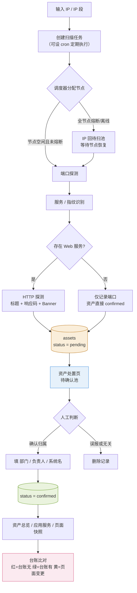

---

## IP 流转：从 IP 段到分片到节点（全链路）

> 这一节对应代码：`internal/service/dispatch.go`、`internal/service/fault.go`、`internal/target/`。
> 一句话：**IP 段 → 展开成 IP 列表 → 每 500 个一片做存活探测 → 存活的进 alivePool → 按 batch_size 切分片 → 派给空闲节点 → 失败的 IP 回池重派 → 池空 + 探完 + 无活跃分片 = 任务结束。**

### 1. 目标展开

| 环节 | 细节 |
|---|---|
| 输入字段 | `scan_tasks.ip_ranges`，一个字符串 |
| 分隔符 | `,` `，` `;` `；` 换行 空格 `、` 都算 |
| 支持的写法 | 单个 IP、CIDR（`10.24.1.0/24`）、区间（`10.24.1.1-10.24.1.20`） |
| 展开函数 | `target.Resolve()` |
| 结果落点 | 内存 `taskPipeline.totalIPs`（全量原始 IP，**不受排除段影响后再过滤**）+ `data/pipeline/<taskID>.json` 断点文件 |

### 2. 流水线（pipeline）与存活探测

每条运行中的任务在内存里有一条流水线：

```go
type taskPipeline struct {
    totalIPs  []string // 展开后的全部 IP
    offset    int      // 已经探测到第几个
    alivePool []string // 已确认存活、还没下发的 IP
    probing   bool     // 正在探测中（防止重复探测）
    dispatching bool   // 正在调度（防止重复下发）
    stopped   bool     // 流水线已废弃（重跑/停止/删除后旧协程必须退出）
}
```

| 项 | 值 / 行为 |
|---|---|
| 探测粒度 | `probeSliceSize = 500`（每片 500 个 IP） |
| 探测方式 | `scanner.AliveCheck.Probe()`（ICMP/TCP 存活） |
| 存活结果 | 追加进 `alivePool`，然后 `offset += 500`，接着立刻触发下一轮调度 |
| 关闭探测（`alive_probe=false`） | `offset` 直接置为满，**全部 IP 一次性进 alivePool**（用于禁 ping / 透明代理干扰的网段） |
| 边探边扫 | 池子攒够 `max(batchSize/5, 10)` 就先发一批，不等整段探完（稀疏网段否则永远发不出去） |
| 探测进度日志 | 每片开始/结束都写 `task_logs`：`[存活] 开始探测第 x-y 个…` |

### 3. 切分片并下发

| 项 | 细节 |
|---|---|
| 分片大小 | `scan_tasks.batch_size`（默认 100 个 IP；用户可改，30 左右更稳） |
| 选节点 | `findIdleNodeExcluding()`：节点 `status=online` + **心跳 < 2 分钟**（`nodeAliveWindow`）+ 未被熔断 + **该节点在本任务里没有 pending/running 分片** |
| 轮询 | 同一轮调度里每个节点最多拿一批（`usedNodes`），避免快的节点吃满、其它节点闲着 |
| 落库 | 一条分片 = `agent_tasks` 一行，`ip_ranges` 是逗号拼接的 IP，`batch_no` 自增 |
| 端口总数预估 | 下发时先按 `IP 数 × 端口数` 估一个 `total`，agent 上报真实值后覆盖 |
| 并发上限 | 一节点一任务同时只有 1 个分片在跑（`findIdleNode` 的第 4 个条件） |

### 4. 节点执行与回报

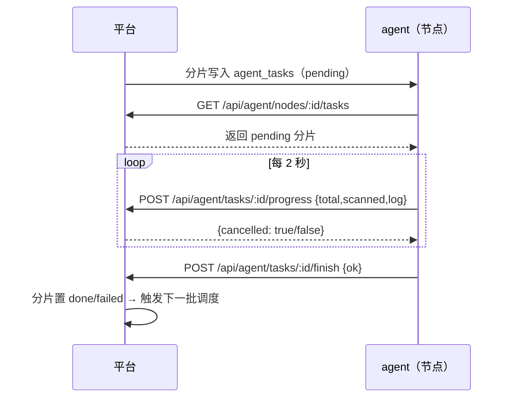

- 分片日志：agent 上报的是**进程级累积日志**，平台按 `[agent-task #id]` 标记切出**本分片**的日志（`updateShardLog`），终端弹窗看的就是它。
- 停止信号：分片状态是 `cancelled` / `done` / `done_ai` / `stalled_ai` / `failed` 时，`/progress` 一律回 `cancelled:true`，agent 收到后杀掉本机扫描进程。

### 5. 三种「IP 回收」路径

> 分片没跑完就把 IP 放回 `alivePool`，由下一次调度重新派给其它节点。这是任务能自愈的关键。

| 触发 | 判定逻辑 | IP 去向 | 分片最终状态 |
|---|---|---|---|
| **节点主动报失败** | `FinishAgentTask(ok=false)` | 回 `alivePool`，`retry_count + 1` | `cancelled`（不计失败） |
| **节点掉线 / 熔断** | `RescheduleOrphanShards()` 每 30 秒巡检：心跳 > 2 分钟或已熔断 | 回 `alivePool` | `cancelled` |
| **扫描停滞** | 看门狗 `checkStalledShards()` 每 30 秒：`scanned` 不增长 **且** 日志不刷新 超过阈值 | `retry_count < 2` 才回池；达到 2 次不再回池 | `stalled_ai`（≥2 次时按进度转 `done_ai` 或 `failed`） |

**看门狗的两个判据**（缺一不可，两个都"死"才判中断）：

1. **进度活性**：`scanned` 在过去 N 分钟内涨过 → 视为活着；
2. **日志活性**：节点终端日志时间戳 `terminal_log_at` 在过去 N 分钟内变过 → 视为活着。

阈值 N：普通任务 **15 分钟**；`port_mode=all`（全端口）**60 分钟**（单片 100×65535 次探测，正常就要 30~60 分钟）。

### 6. 任务什么时候算「完成」

`CheckTaskAllDone()` 三个条件必须同时满足：

1. 存活探测全部结束：`probing == false` 且 `offset >= len(totalIPs)`
2. 待下发池已空：`len(alivePool) == 0`
3. 没有 pending/running 分片：`COUNT(agent_tasks WHERE status IN ('pending','running')) == 0`

满足 → `scan_tasks.status = done`。

特例：一个分片都没下发、且全部 IP 不可达 → 直接 `done`，日志写 `[存活] 全部 N 个 IP 均不可达，任务结束`。

### 7. 断点续传

| 项 | 细节 |
|---|---|
| 落盘文件 | `data/pipeline/<taskID>.json`（offset + 待下发池） |
| 写入时机 | 每批下发后、每片探测后、IP 回收后 |
| 恢复时机 | 服务启动时 `ensurePipeline()` 优先读文件（比 DB 的 `probe_offset` 更完整） |
| 废弃保护 | 任务重跑/停止 → `pipeline.stopped = true`，旧协程拿到标记后退出，不会凭空再造一条流水线并行跑 |

---

## 状态流转：所有状态机

### 1. 扫描任务 `scan_tasks.status`

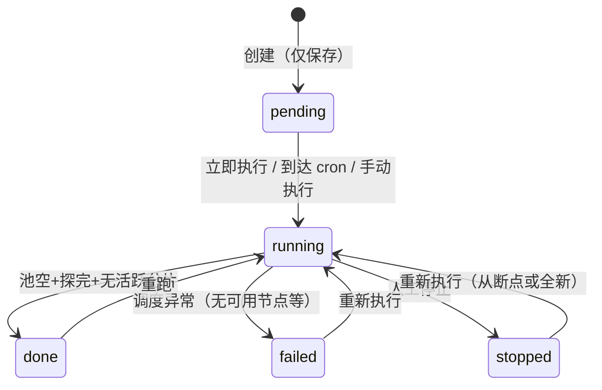

### 2. 分片 `agent_tasks.status`

| 状态 | 谁写的 | 含义 | agent 是否被杀掉 |
|---|---|---|---|
| `pending` | 调度器 | 已下发，等节点领取 | — |
| `running` | agent 首次上报进度 | 正在扫 | — |
| `done` | agent `finish(ok=true)` | 正常跑完 | 是（防止进程残留） |
| `done_ai` | 看门狗诊断 | 日志显示跑完但没收到结束信号，按完成收尾 | 是 |
| `stalled_ai` | 看门狗诊断 | 判定卡死，IP 回收重派 | 是 |
| `failed` | agent `finish(ok=false)` / 多次回收仍停滞 | 失败 | 是 |
| `cancelled` | 人工停止 / 节点掉线回收 / 失败回收 | 已回收，**不计入失败**，IP 已回池 | 是 |

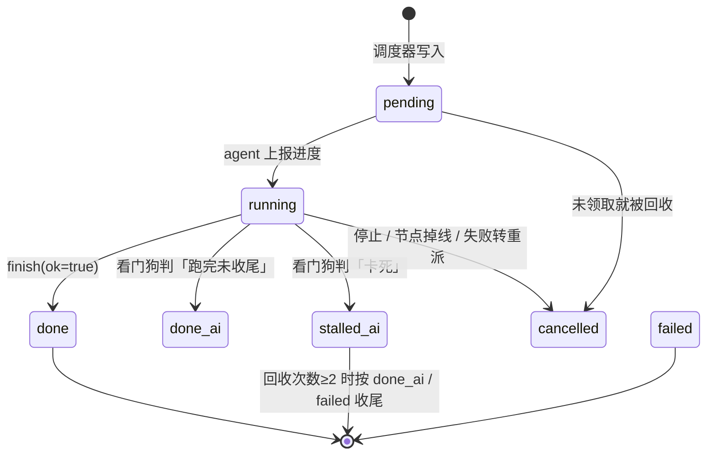

### 3. 节点 `nodes.status`

| 状态 | 判定 |
|---|---|
| `online` | 每次心跳刷新 `last_heartbeat`，且 `status` 置 online |
| `offline` | 心跳超时（派发时按 **2 分钟** 判定 `nodeAlive`，不看库里的 status，避免用到过期状态） |
| 熔断 | 独立于 status：连续失败会进熔断期（`IsNodeFused`），熔断期内不派发 |

### 4. 服务 `services`

| 字段 | 流转 |
|---|---|
| `first_seen` | 首次扫到时写入，之后不再变 |
| `last_seen` | 每次扫到都刷新 |
| `miss_count` | 本轮没扫到 +1，**连续 3 次没扫到就删除该服务行**（`markMissingServices`） |
| `confirmed` | 处置确认后置 true；**端口级**，确认基线写 `confirmed_title` |
| `confirmed_title` | 该端口确认时的标题基线（迁移 039 新增） |
| `title_source` | `tscan`（历史枚举值，现指「扫描器给的」）/ `fingerprint`（指纹命中）/ `ai`（AI 识别写回） |
| `prev_title` / `prev_fingerprint` / `prev_status_code` / `prev_content_length` | 发生变更时留旧值，待处置页展示「旧→新」 |
| `page_simhash` | 当前页面内容 SimHash |

### 5. 资产 `assets`（**一个 IP 一行**，`ip` 是唯一索引）

| 字段 | 取值 / 流转 |
|---|---|
| `source` | `ledger`（台账导入）/ `scan`（扫描自动建） |
| `status` | `pending`（有这个 IP 的待处置 web 端口）/ `confirmed`（已处置） |
| `system_name` / `owner` / `department` | 人工确认时写入；**这三个字段非空即视为「有确认痕迹」** |
| `confirmed_title` / `confirmed_simhash` | IP 级确认基线（端口级缺失时兜底） |
| `content_changed` | 页面内容 SimHash 与确认基线汉明距离 > 16 时置 true；重新确认后清零 |

**扫描时资产的建立规则**（`ingestService`）：

- 新 IP + **非 web** 服务 → 建资产 `source=scan, status=confirmed`（主机不需要确认）
- 新 IP + **web** 服务 → 建资产 `source=scan, status=pending`（进待处置）
- 已有主机记录又新发现 web 服务、且该资产没填过归属 → `status` 从 confirmed 转回 `pending`

### 6. 待处置页的四种呈现（判定顺序）

`listDisposalItems()` 逐端口判定，**顺序不能乱**：

| 顺序 | 条件 | 结果 |
|---|---|---|
| 1 | 该 IP 在 `assets` 里不存在 | `new` 新出现（红）；若该端口已确认则不显示 |
| 2 | `assets.source = ledger` | 走台账口径：端口未确认 → `in_ledger`；已确认且有变更 → `changed`；已确认且无变化 → **不显示** |
| 3 | 有确认痕迹（确认过标题/指纹，或填过归属） | 端口未确认 → `in_ledger`（已确认 IP 上的新端口）；已确认且有变更 → `changed`；无变化 → 不显示 |
| 4 | 只有扫描自动建的主机记录（无任何归属） | `new` 新出现（红） |

> `changed` 的两个独立来源：**标题与端口基线不同** 或 **`assets.content_changed = true`**。

### 7. 新旧识别合并口径（重要）

> 代码：`internal/scanner/merge.go` 的 `MergeIdentification()`。
> 目标：**避免刷出无意义「新变更」，但真实变更必须暴露。**

| 序号 | 条件 | 处理 |
|---|---|---|
| 1 | 旧值为空 | 用新值 |
| 2 | 新值为空 | 用旧值（扫描器这次没拿到标题，不覆盖） |
| 3 | 旧值是通用词、新值有信息量 | 用新值 |
| 4 | **两边都是通用词**（Login / Loading…） | **保留旧值**，不标变更（纯抖动） |
| 5 | **表意一致**（`titleSimilar`） | **保留旧值**，不标变更 |
| 6 | **表意不一致** | **用新值**，标记「新变更」 |

`titleSimilar` 的判定（三级，任一命中即算一致）：

1. 归一化后相同 —— 去大小写/空格/标点，并剔掉「系统/平台/管理系统/登录/首页/admin…」等噪声词；
2. 一方包含另一方，且长度比例 ≥ 0.5（例：`中化云盘` ⊂ `中化云盘 - 登录`）；
3. 字符 3-gram Jaccard 相似度 ≥ 0.8。

**页面内容变更**：`similarity.Changed(确认时 SimHash, 当前 SimHash, 16)` —— 汉明距离 > 16 即判定页面实质变更，
写 `assets.content_changed = true`，待处置页标黄。阈值取 16 是实测结果：同一系统小改版约 10~14，完全不同系统约 28~35。

### 8. 识别链路（AI 服务识别）

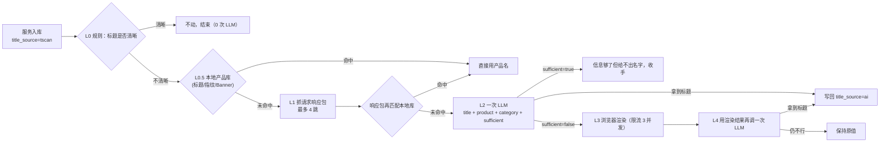

## 架构说明

```
┌─ 服务端 (asset-server) ──────────────────┐
│  API 服务 + 任务调度 + 数据入库          │
│  端口: 18888                             │
└──────────────────────────────────────────┘
            ↑ HTTP (心跳/任务/结果)
┌─ 扫描节点 (asset-agent) ─────────────────┐
│  自研引擎扫描 + 流式结果上报             │
│  支持 Windows / Linux / ARM64            │
└──────────────────────────────────────────┘
            ↓ 扫描结果
┌─ PostgreSQL + Redis ────────────────────┐
│  资产 / 任务 / 服务 / 合规 / 快照        │
└──────────────────────────────────────────┘
```

## 数据持久化

| 数据 | 卷映射 | 说明 |
|---|---|---|
| PostgreSQL | `pg-data` | 资产/任务/扫描结果 |
| Redis | `redis-data` | 缓存 |
| JWT 密钥 | `./data/files` | 登录凭证 |
| 升级备份 | `./data/backup` | 系统升级前的二进制 |
| 节点引擎审计库 | `agent-engine-config` | agent 本地 config.db（排障用，v0.0.27.1 由 `agent-tscan-config` 改名） |


## 所有功能介绍

### 首页
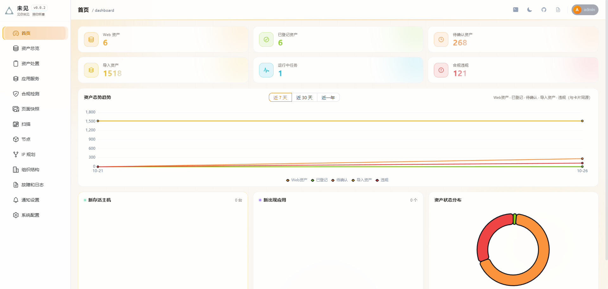
首页主要是对各种数据进行汇总展示，并绘制趋势图。除此之外没有别的功能。

### 资产总览
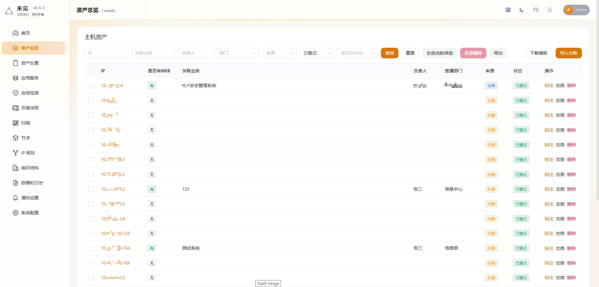
1. 根据可下载的模板导入现有台账，其中的组织和各组织负责人会被自动添加在组织结构页面。
2. 根据每一次扫描的结果查看态势，连续三次扫描均不存活的资产会被剔除。
3. 可以再次对资产进行标注。

### 资产处置
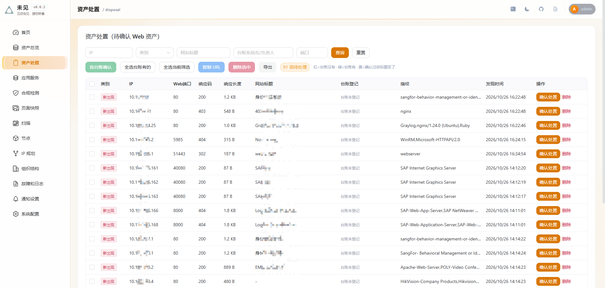
1. 对扫描到的web服务均放置于此处，即便是导入的台账的资产依旧会需要再次处置。
2. 有三种标签，新出现，台账有，新变更。新出现指的是不在台账中的新被发现的web服务；台账有指台账中的被扫描到的资产；新变更指的是以前处置过的但是服务产生变更的。
3. 判断旧服务是否变更使用的技术是simhash,类似于yakit的页面相似度。

### 应用服务
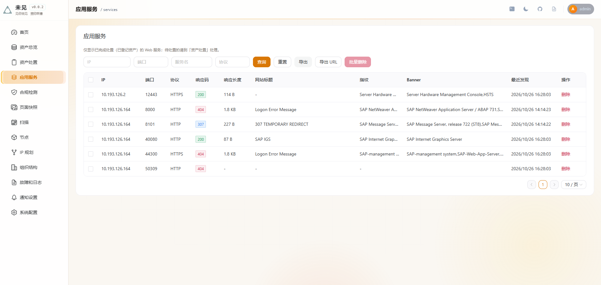
1. 对已处置的web服务进行展示和编辑操作。

### 合规检测
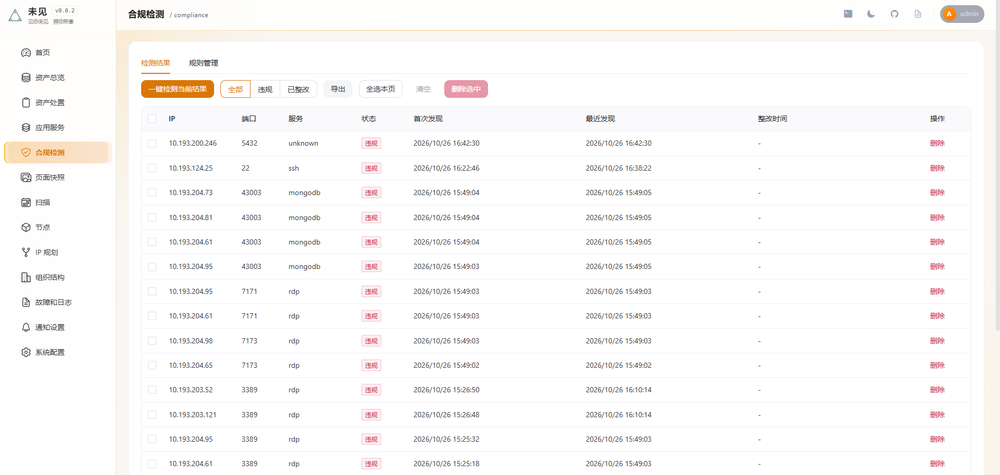
1. 对扫描中发现的可直连的数据库，ssh等进行展示，同时可以一键复测。
2. 可以自定义规则。

### 扫描
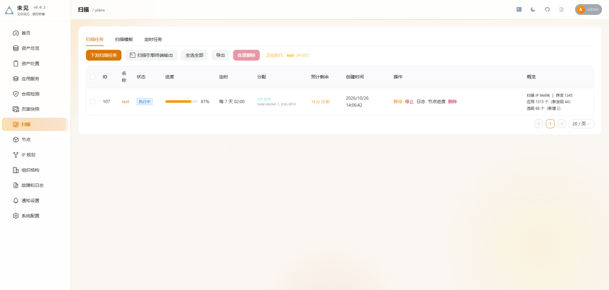
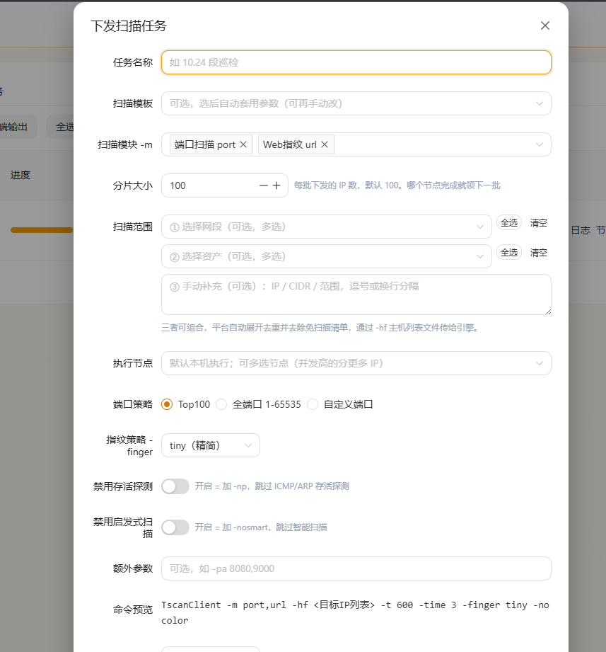
1. 下发任务，可以选择节点和配置各项参数，任务成果会在最右侧显示，显示结果随每次任务刷新。
2. 引擎的 connect 扫描天然不做 ICMP 预探测，服务端另用 icmp+tcp 先判定存活，在探测过程中，依据设定的分片数动态给子节点下发任务，如果暂停再继续，存活探测可以断点续传，下发的没有完成的分片会重新下发。
3. 可以编辑扫描策略模板。
4. 可以设定定时任务，定时任务子页面可以看到每一次定时任务的详情。
5. 扫描任务中可以便捷的设置各类参数。

### 节点
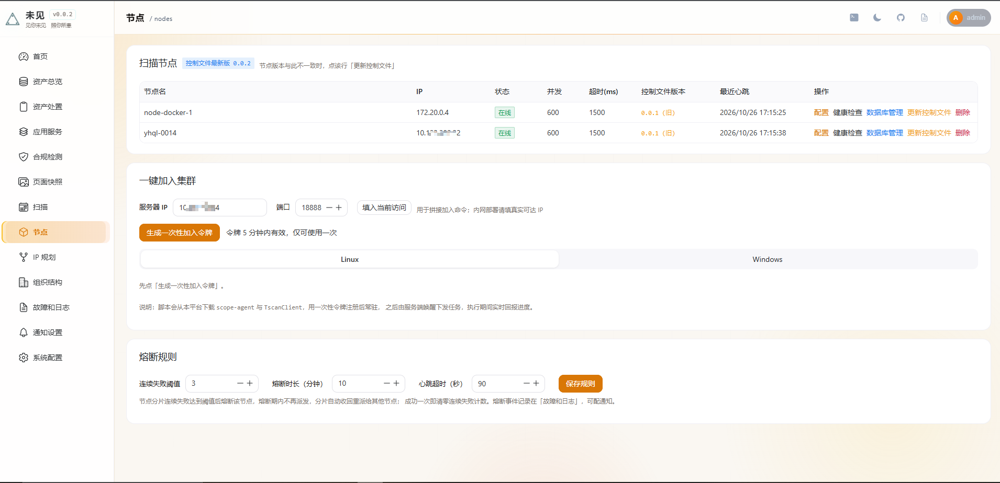
1. 一键加入集群，兼容linux和windows，可以选择单独下载控制文件或者完整下载（包含引擎），仅有控制文件无法完成扫描。
2. 根据节点性能可以设置每一个节点的并发。
3. 可以对子节点数据库进行管理，节约存储。
4. 可以设置熔断规则，对于连续失败的节点会熔断，规定时间内不再下发任务。
### IP规划
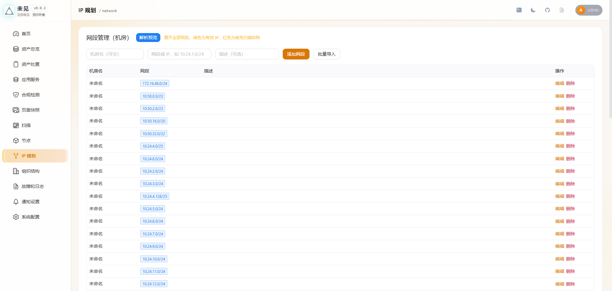
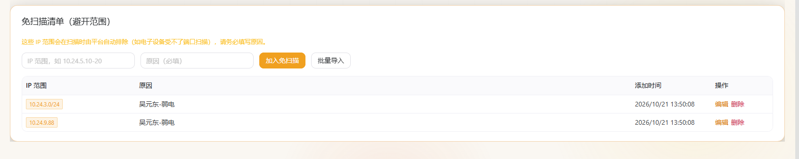
1. 预先导入一些内网段，扫描时一键选中。
2. 预先设置一些免扫描范围，扫描时自动排除。

### 组织结构
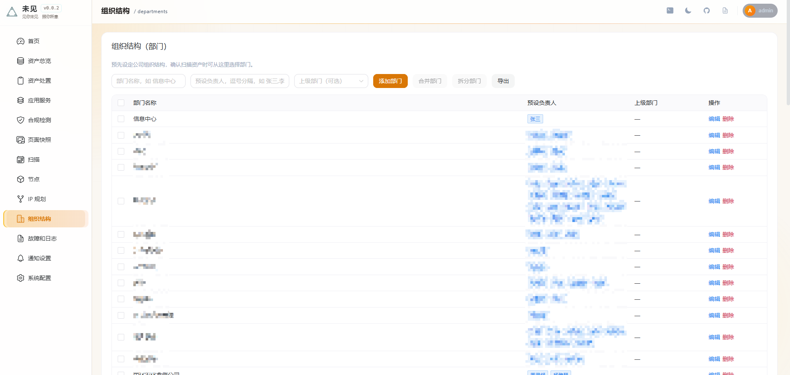
1. 可以合并拆分组织，可以编辑组室内负责人。

### 故障和日志
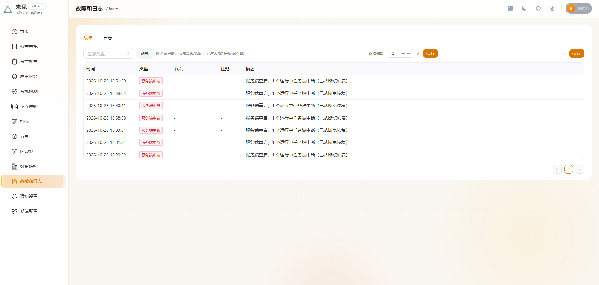
1. 显示故障和日志。

### 通知
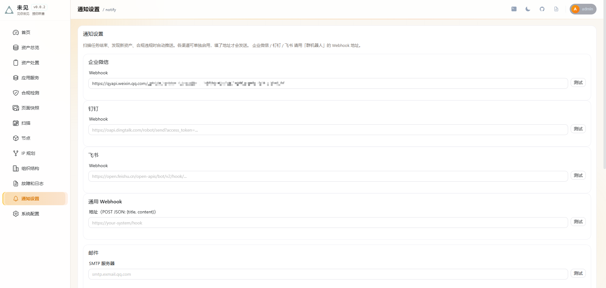
1. 可以通知，支持大多数常用的软件。

### 系统配置
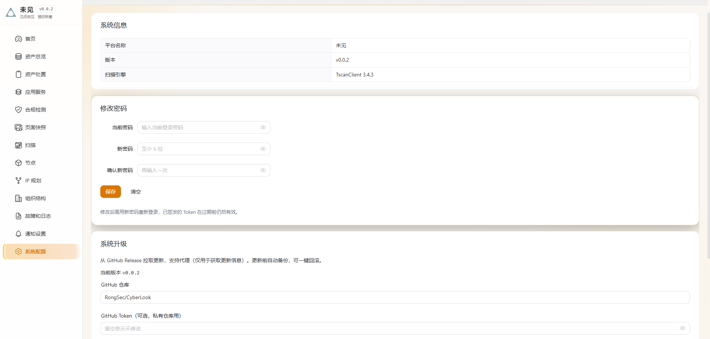
1. 一键升级，支持回滚。
2. 可以修改密码。

## 端口说明

| 端口 | 用途 |
|---|---|
| **18888** | Web 界面 + API（默认，可改） |
| 5432 | PostgreSQL（内部） |
| 6379 | Redis（内部） |

**修改端口**：系统配置 → 服务端口 → 保存 → 重启

## 故障排查

**问题：服务访问不到**
```bash
docker compose ps                    # 查看容器状态
docker compose logs server           # 查看日志
docker compose restart server        # 重启
```

**问题：节点离线**
```bash
# 检查 agent 日志
tail -f /opt/dongruo-agent/agent.log

# 重新加入
bash install.sh amd64
```

**问题：更新后二进制丢失**
```bash
# docker cp 的二进制会被容器重建丢弃，正确顺序：
docker cp asset-server-linux asset-server:/app/asset-server
docker compose restart server        # 不要用 up -d
```

## 版本更新

### 发布（维护者）

打 tag 即可，GitHub Actions 会自动构建并推送镜像：

```bash
git tag v0.0.4
git push origin v0.0.4
```

产出：
```
ghcr.io/rongsec/cyberlook:v0.0.4         主镜像（后端 + 前端 + 分发的 agent 二进制，自研引擎内置）
ghcr.io/rongsec/cyberlook-updater:v0.0.4 更新边车镜像
```

> 首次发布需在 GitHub → Settings → Actions → General 里允许 workflow 写入 packages（默认已允许）。

### 在线更新（使用者）

**方式一：页面点更新**

```
系统配置 → 系统更新 → 检查更新 → 更新
```

背后流程：
```
page 调 /api/system/update/apply {version}
  → 主应用转发给 updater 边车（http://updater:9999/update）
  → updater: pg_dump 备份 → 改 .env 的 APP_VERSION → docker compose pull server
             → docker compose up -d --no-deps server → 健康检查
             → 失败自动回滚到旧版本
```

**updater 边车**是唯一挂载 `/var/run/docker.sock` 的容器，主应用不碰 docker 权限。

**方式二：命令行兜底**

```bash
bash update.sh v0.0.4
```

脚本做同样的事（备份 → 改版本 → pull → 重启 → 健康检查 → 失败回滚）。

### 回滚

```bash
# 改回旧版本号，重新拉取
bash update.sh v0.0.3
```

数据库备份在 `data/backup/pre-update-<时间戳>.sql`。

### 部署形态说明

| 组件 | 更新方式 |
|---|---|
| 后端 + 前端 + agent | **镜像更新**（`docker compose pull`） |
| 数据库 schema | 启动时自动执行 `migrations/*.sql`（向前兼容） |
| 业务数据 | 挂载卷，不随镜像变化 |

## 版本记录

### v0.0.2（2026-10-26）

**扫描**
- 断点续传：探测进度 + 待扫池文件落盘，重启自动恢复
- 任务控制拆分：停止 / 暂停 / 继续 / 重跑
- 持续存活探测：不再等端口扫描消耗，池子持续积累
- 节点熔断：连续失败阈值触发，自动退避 + 分片重派

**资产**
- 修复处置后不从列表消失（`category=new` 未检查已确认状态）
- 修复处置后资产不出现在总览/应用服务（确认时自动创建 assets 记录）
- 首页「Web 资产」改为服务条数统计，与服务页口径统一
- 任务概览改为「本次执行」时间窗口，不再跨多次执行叠加

**组织**
- 从资产同步组织架构，支持一个部门多个负责人（逗号/顿号/分号/斜杠分隔）
- 部门编辑、合并、拆分
- 部门/负责人新建按钮（处置弹窗内）

**监控**
- 新增「故障和日志」页
- 故障记录保留期可配（默认 30 天，每日 03:00 清理）
- 服务端重启仅在中断运行中任务时记录，正常重启不产生噪音

**通知**
- 修复 webhook 失败被静默吞掉（现在解析 errcode/code，返回真实错误）
- 新增「故障告警」开关

**安全**
- 修复 `AgentTaskAuth` 未携带 token 时放行的问题（默认拒绝）
- 修复截图路径遍历、页面图片路径遍历
- 故障记录范围收窄，避免误报

### v0.0.1（初始版本）

- 分布式端口/Web 扫描、资产台账、处置、合规检测、页面快照、定时任务、通知、在线升级

## 扫描引擎

自研引擎是**唯一**引擎（`internal/portscan` + `internal/svcid`，全量 FingerprintHub 规则）。
v0.0.27 起 TscanPlus 已彻底移除：`TscanClient` 执行链、`tscan-binary` 分发路由、
`SCAN_ENGINE=tscan` 回退开关全部删除，没有回退路径。
实测对比见 `docs/端口扫描对拍报告-2026-11-09.md`。

### ⚠️ agent 必须能读到指纹规则目录（否则静默降级为纯端口扫描）

agent 端的服务识别依赖 FingerprintHub 全量规则（`SCAN_RULES_DIR`，默认相对路径
`data/fingerprint`）。目录不可用时**不会报错退出**，只在任务日志里留一行

```
[自研引擎] 规则载入失败，仅做端口扫描：规则路径 data/fingerprint 不可用: stat data/fingerprint: no such file or directory
```

随后该节点扫出来的结果「已识别」恒为 0、`fingerprint`/`product` 全空——看上去"能扫"，实际没有识别。
部署时二选一（推荐前者）：

1. **镜像内置**（默认）：`Dockerfile.agent` 已 `COPY data/fingerprint /app/data/fingerprint`
   并 `ENV SCAN_RULES_DIR=/app/data/fingerprint`，节点离线也能识别，约 +11MB 镜像体积。
2. **宿主机挂载覆盖**：想换规则不重建镜像时，在 `docker-compose.yml` 的 agent 服务打开
   `- ./data/fingerprint:/app/data/fingerprint:ro`（只读）。

验收：
```bash
docker exec asset-agent ls /app/data/fingerprint | wc -l        # 期望非 0（≥2：web/service 两个 json）
docker logs asset-agent 2>&1 | grep "识别=true"                  # 期望「识别=true，全量指纹=true」
```

### 存活探测（ICMP + TCP 两阶段）

开启后由**服务端**先探一遍，只把存活 IP 入队；关闭则全量入队。判定链：

| 阶段 | 手段 | 判定 |
|---|---|---|
| 1 | ICMP Echo（非特权 udp4，`ping_group_range` 允许即可；无权限自动跳过） | Echo Reply → 存活；Destination Unreachable → 判死并跳过阶段 2 |
| 2 | TCP connect 到 16 个常见端口（80/443/22/445/135/139/3389/8080/8443/9443/3306/6379/1433/5432/27017/9200） | SYN-ACK 或 RST → 存活；全部超时 → 判死 |

单机 TCP 探测 4 路并行、命中即取消，超时 350ms。实测 10.193.0.0/16（65,536 个 IP）：
605 台存活，ICMP 命中 295、TCP 补命中 310，耗时约 2 分钟。

> 只做 TCP 会漏很多：同一批数据里 **312 台（52%）五个常用端口全不通**，只按 TCP 判会全部漏掉；
> 反过来只做 ICMP 会漏掉 310 台（它们不响应 ping）。所以两层是互补关系，缺一不可。

### 智能调速（默认开启，不需要手配 K / limit）

从上表能看出一个事实：**没有一个固定并发值适合所有机器**。4 核 8G 给 1500 会撞 CPU 墙，
2 核 4G 给 1500 会 OOM，而 8 核 16G 给 600 又浪费一半吞吐。所以默认改成闭环自动决定：

```
天花板 base = min(fd 预算, CPU 核数×350, 内存MB×3)   ——  钳在 [200, 4000]
起步 = base × 3/4，然后每 10 秒看一次反馈调整
```

三条反馈与动作：

| 信号 | 来源 | 动作 | 为什么 |
|---|---|---|---|
| 本地资源错误（EMFILE/ENOBUFS） | 引擎每轮 `Stats.LocalResErrs` 进程级累计 | **×0.6** | 已越 fd 墙，这是硬错误不是慢 |
| CPU > 90%（连续 2 个窗口） | `/proc/self/stat` utime+stime 差分（进程自身，不是整机 load） | ×0.8 | 再加并发只会拉长每个探针延迟，吞吐不升反降 |
| CPU < 70% 且本窗口有探针 | 同上 | ×1.15（不超 base） | 试探性上调，撞墙下一轮自动退回，代价很小 |

几个刻意的设计：

- **空闲窗口不动**：本窗口零探针（任务暂停/没任务）时，哪怕 CPU 很低也不上调，避免空推把值推歪。
- **人在调的时候机器让位**：服务端下发 `limit`/`pause` 后 **5 分钟内**自动挡不干预
  （`scanner.AutoManualHold`），否则会出现"我设 60，十秒后被自动推回 1200"。
- **暂停中的任务不碰**：`Paused()` 时不会偷偷 `SetLimit` 把任务复活。
- **看不到 CPU 就退化为只看 fd**：Windows / 非 Linux 读不到 `/proc`，此时闭环只按 fd 预算跑。

日志示例（每次调整打一行，可直接判断它为什么动）：

```
[auto] 智能调速启用：本机 4 核 / 7902MB，fd 预算 1500 → 在途天花板 1400，起步 1050
[auto] 在途上限 1050 → 1207（CPU 有余量；CPU 38%，本机 4 核 / 7902MB，fd 预算 1500，本窗口 12800 探针）
[queue] 任务 #188 智能调速：在途上限 → 1207
[auto] 在途上限 1207 → 966（本地资源错误 2 次；CPU 61%，…）
```

开关与上限（环境变量，节点侧）：

| 变量 | 默认 | 说明 |
|---|---|---|
| `SCAN_INFLIGHT_AUTO` | 开 | `off` 关闭，回到节点固定并发 |
| `SCAN_INFLIGHT_MAX` | 无 | 硬上限，覆盖算出来的 base（例如给节点限流 800） |

**K 也跟着自动算**：`K = ceil(在途目标 ÷ 单元端口数)`，钳在 `[节点配置的 K, 32]`。
原因是 limit 与 K 是两个不同的闸——总在途 ≈ `min(K × 单元端口数, limit)`。
top100 的单元只有 100 个探针，固定 K=6 会把在途钉死在 600，此时 limit 调到 1400 也用不上；
反过来全端口扫描（65535/单元）会被算成 K=1，避免一个单元 spawn 6 万个探针 goroutine。

> 手动挡仍然有效：`/control limit` 想在自动挡之上"钉死一个值"时，把 `SCAN_INFLIGHT_AUTO=off` 关掉更干脆。

### 并发与 fd 调参表（v0.0.27 实测，4 核 / 8GB / connect 扫描）

自研引擎是 **connect 扫描：每个在途探针一个 socket**，所以「并发（limit）× 单元端口数」必须
小于节点 `nofile`，否则会撞 fd 墙——历史上撞墙的探针会被当成"端口关闭"，产出**假阴性**
（v0.0.27 已修：现在撞墙会被识别为资源错误并让单元失败重试/隔离，日志打 ERROR）。

一个节点同时跑 K 个 IP 单元（`QUEUE_UNIT_CONCURRENCY`），K 路共用同一个 limiter（节点并发），
因此：**总在途探针 ≈ min(K×单IP端口数, 节点并发)**，稳态吞吐 ≈ 总在途 ÷ 单探针延迟（常见 2s 超时）。

机器规格：4 vCPU / 7.9GB（与其他容器共用，agent 自身 RSS 峰值 64MiB）。

| K | 节点并发(limit) | nofile | /24×100 端口(25,600 探针) | 等效 pps | agent CPU 峰值 | agent RSS 峰值 | 适用规模 |
|---|---|---|---|---|---|---|---|
| 6  | 600  | 65535 | 89s | 288 | 60% (4核) | 23.5MiB | 默认值，最稳；小机器/低配节点 |
| 16 | 1600 | 65535 | 36.2s | 707 | 129% (4核) | 63.8MiB | 中段 /24 ～ /23 |
| 32 | 1500 | 65535 | **23.8s** | **1076** | 143% (4核) | 60.4MiB | 大段 /24 及以上（对齐 ab3 老引擎 1035pps） |
| 32 | 8000 | 65535 | —（未压测） | 理论上限 ≈ 8000÷2s＝4000 | — | — | 有足够 fd/带宽时 |

对等性硬断言（同一目标段 × 同一 100 端口清单，K 变化不得改变结论）：
`probes_done = probes_total = 25600`、`units_done=256 / failed_unit=0`、开放数 **327 恒定**
（K=6 / 16 / 32 三组各 327，双向 diff 0 条）。

三条硬约束：
1. **nofile 必须 ≥ 在途探针数 + 256**：容器默认 1024 只够 ~700 在途，务必 `ulimits.nofile: 65535`
   （compose 已写死）。agent 启动会自检 `RLIMIT_NOFILE` 并打印：
   `nofile=65535 ≥ 8192，扫描在途上限按 1500 运行` / `⚠️ nofile=1024，高并发会触发假阴性风险…已钳到 768`。
2. **K 只放大租约在途数，不放大发包速率**：真正决定流量的是节点并发（limiter），
   `/control limit` 与暂停对 K 路同时生效。
3. **单元端口数别超 limit/K**：例如 1-65535 全端口扫描时，单 IP 就有 65535 个探针，
   此时 K 再大也受 limit 限制（K 的作用是隐藏 claim 往返，实测 K=16→32 把 449pps 拉到 1076pps）。

对等性（开放端口数）已验证：K=6 / K=16 / K=32 三种配置跑同段同端口，结果集**逐条完全一致**
（327 条，双向 diff 均为 0）——并发不改变结论，只改变耗时。

### 动态调速（`/control limit`、pause / resume）在 K>1 下确实生效

`limit` 调的是**许可数（在途探针上限）**，不是 pps 直接读数：稳态 `pps ≈ limit ÷ 单探针延迟`。
所以验收看「同段同端口，改 limit 后 pps/墙钟成比例变化，且结果集不变」。

实现要点（v0.0.27.1 修复）：共享 limiter 的键是 **taskID**（不是单元级 projectID），
K 个单元取同一个 ctrl；投影挂在 2s 心跳 + claim 响应上，带单调递增 `seq` 做乱序防护
（老心跳晚到直接丢弃），任务收敛时释放句柄。详见 `internal/scanner` 的
`EnsureTaskCtrl / ApplyTaskCtrl / UnregisterTaskCtrl`。

实测（同 `/24 × top100`，不改任何扫描参数，只改 limit）：

| K | 基线 pps（limit=600/1500） | limit=60 后 | 结论 |
|---|---|---|---|
| 6  | 300 | 41 / 68 / 77 / 88（4 次 4s 采样，均值≈60） | 成比例下降到 ≈60；再改回 600 → 恢复 300 |
| 1  | 50（单 IP 串行，自然上限≈50） | limit=20 → 5 / 10 / 33 / 40（均值≈20） | K=1 语义与 K>1 一致，未被改坏 |
| 32 | ~600 | 全程 limit=60：**墙钟 455s、均速 56pps、probes 25600/25600、open 327** | 比基线 23.8s 慢 19 倍，结果零丢失 |

pause → `pps=0`（全部在途单元冻结，不只是 tick 到的那个）；resume → 恢复，均 ≤2s 生效
（agent 日志：`调控：全部在途单元已暂停（task#177 seq=3）` / `调控：限速 limit=60 … seq=1`）。

## 许可证

**GPL-3.0** — 详见 [LICENSE](LICENSE)（GNU GENERAL PUBLIC LICENSE, Version 3, 29 June 2007）

本项目按 GPL-3.0 开源，**不作商业用途**。由此可以合法使用同样采用 GPL-3.0 的第三方数据
（如 Wappalyzer 系列规则库）；引入时须在 `THIRD_PARTY_NOTICES.md` 中登记来源与授权。

当前随项目分发的规则数据：
- `data/fingerprint/web_fingerprint_v4.json`、`service_fingerprint_v4.json` — FingerprintHub（0x727），**MIT**，
  随目录附 `LICENSE.md`
- 所有 Go 依赖均为 MIT / Apache-2.0 / BSD 类，**未引入 GPL 数据的 Go 模块**（详见 `THIRD_PARTY_NOTICES.md`）

> 若将来需要以闭源/一体机形式交付客户，必须先移除 GPL 数据依赖并重新评估协议，
> 因为 MIT 包装无法消除 GPL 数据集的 copyleft 义务。


**使用前请遵守**：
- 不得用于非法用途
- 扫描目标需获得授权
- 遵守当地法律法规
