<div align="center">
  
  <h1>未见</h1>
  <p><em>见你未见 · 照你所患</em></p>
  <p>
    
    
    
    
  </p>
</div>

未见是一个企业内网资产发现、合规检测与处置管理平台。致力于基于事实发现的内网资产动态维护。

**核心能力**：分布式端口/Web 扫描 → 存活探测 → 资产处置 → 组织归属 → 合规检测 → 变更感知
## 
本项目无一行人类代码，将来也不会使用一行人类代码。但所有功能均经过人类验证。0.0.2版本为功能完善的第一次发版，目前已进入长期维护阶段。

测试环境：麒麟，ubuntu,windows。

测试目标：真实企业内网共94653个IP

## 特别鸣谢
- https://github.com/TideSec/TscanPlus
- 本系统核心扫描能力均依赖于内嵌的tscanclient,日后也会对tscanclient的更新在第一时间做主动适配。

## TODO
- 暂停在继续后扫描任务的概览会重复一次分片计数（不影响功能和数据）
## 功能特性

- **资产发现**：基于 TscanClient 的端口扫描、Web 指纹识别
- **分布式扫描**：多节点（支持 Windows/Linux）批量调度，可对节点单独设置参数，灵活分片，敏捷调度
- **资产处置**：按分类处置资产（新出现 / 新变更 / 台账导入）
- **SimHash 内容变更检测**：基于页面内容指纹判断资产是否改版，避免重复劳动
- **合规检测**：记录在扫描中发现的可直连数据库等违规操作，可自定义规则
- **页面快照**：Web 资产截图留存
- **定时任务**：支持对扫描任务定时执行，可自动分发到节点
- **通知**：企业微信 / 钉钉 / 飞书 / 通用 Webhook / 邮件，支持按事件类型（任务完成/新资产/违规/故障）分别开关
- **断点续传**：探测进度与待扫池落盘（`data/pipeline/<taskId>.json`），服务重启自动从断点恢复，不丢存活 IP
- **任务控制**：停止 / 暂停 / 继续 / 重跑四态分离；暂停时未完成分片自动收回待扫池，继续时重新派发
- **熔断与自动重派**：节点连续失败达到阈值自动熔断（默认 5 次 / 5 分钟，可在节点页配置），熔断期分片收回并重派其他节点
- **故障与日志**：记录服务端中断、节点离线、节点熔断、分片失败；故障记录默认保留 30 天（可调），可配通知
- **组织架构**：从资产自动同步部门与多负责人，支持部门合并/拆分，拆分时按负责人分配
- **持续存活探测**：探测不等端口扫描消耗，存活 IP 持续攒入待扫池
- **系统在线升级**：从 GitHub 拉取更新，支持代理与回滚

## 技术栈

| 组件 | 技术 |
|---|---|
| 后端 | Go 1.21+ (Gin + GORM) |
| 前端 | Vue 3 + Naive UI + ECharts |
| 数据库 | PostgreSQL 16 + Redis 7 |
| 扫描引擎 | TscanClient |
| 部署 | Docker Compose |

## 快速开始

### 1. 环境要求

- Docker 20+ / Docker Compose 2+
- 仅二次开发需要：Go 1.21+、Node.js 18+

### 2. 一键部署

> **无需手动编译**。`docker compose` 使用多阶段构建（Node + Go），前后端在镜像内自动编译。


**Linux / macOS**：
```bash
cd asset-platform
bash init.sh
```

**Windows (PowerShell)**：
```powershell
cd asset-platform
.\init.ps1
```

**脚本自动完成**：
1. 生成 `.env`（**随机数据库密码**，用户无需关心）
2. 启动 Docker 服务（多阶段构建自动编译前后端）

**默认端口**：`18888`（可在系统配置页修改）

**访问**：`http://localhost:18888`

**默认账号**：`admin` / **默认密码**：`admin123`（首次登录后请修改）


## 目录结构

```
asset-platform/
├── cmd/                    # Go 入口
│   ├── server/             #   服务端
│   └── agent/              #   扫描节点
├── internal/               # Go 业务代码
│   ├── api/                #   HTTP 接口
│   ├── service/            #   业务逻辑
│   ├── scanner/            #   TscanClient 封装
│   ├── similarity/         #   SimHash 相似度
│   ├── model/              #   数据模型
│   └── config/             #   配置
├── web/                    # 前端（Vue 3）
├── migrations/             # SQL 迁移
├── docker-compose.yml      # Docker 编排
└── README.md
```

## 架构说明

```
┌─ 服务端 (asset-server) ──────────────────┐
│  API 服务 + 任务调度 + 数据入库          │
│  端口: 18888                             │
└──────────────────────────────────────────┘
            ↑ HTTP (心跳/任务/结果)
┌─ 扫描节点 (asset-agent) ─────────────────┐
│  TscanClient 扫描 + 结果上报             │
│  支持 Windows / Linux / ARM64            │
└──────────────────────────────────────────┘
            ↓ 扫描结果
┌─ PostgreSQL + Redis ────────────────────┐
│  资产 / 任务 / 服务 / 合规 / 快照        │
└──────────────────────────────────────────┘
```

## 数据持久化

| 数据 | 卷映射 | 说明 |
|---|---|---|
| PostgreSQL | `pg-data` | 资产/任务/扫描结果 |
| Redis | `redis-data` | 缓存 |
| JWT 密钥 | `./data/files` | 登录凭证 |
| 升级备份 | `./data/backup` | 系统升级前的二进制 |
| TscanClient 配置 | `tscan-config` | 扫描结果缓存 |


## 所有功能介绍

### 首页
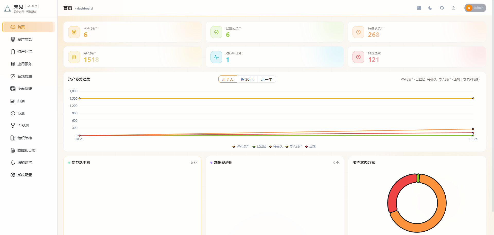
首页主要是对各种数据进行汇总展示，并绘制趋势图。除此之外没有别的功能。

### 资产总览
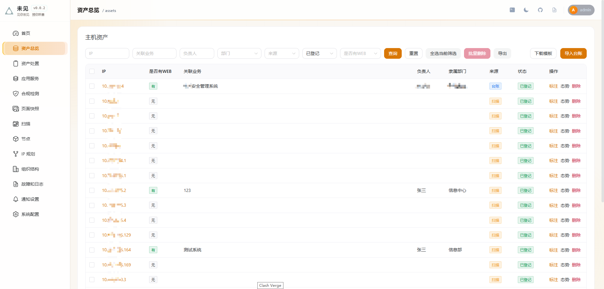
1. 根据可下载的模板导入现有台账，其中的组织和各组织负责人会被自动添加在组织结构页面。
2. 根据每一次扫描的结果查看态势，连续三次扫描均不存活的资产会被剔除。
3. 可以再次对资产进行标注。

### 资产处置
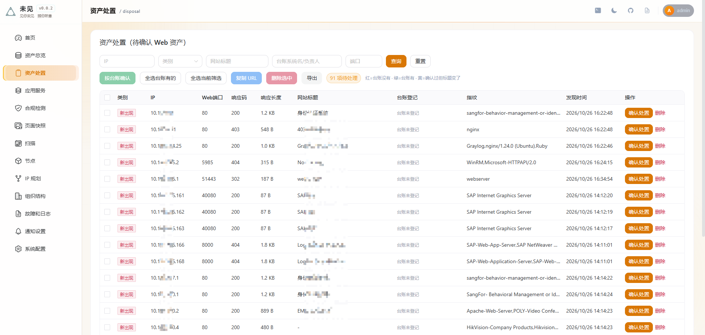
1. 对扫描到的web服务均放置于此处，即便是导入的台账的资产依旧会需要再次处置。
2. 有三种标签，新出现，台账有，新变更。新出现指的是不在台账中的新被发现的web服务；台账有指台账中的被扫描到的资产；新变更指的是以前处置过的但是服务产生变更的。
3. 判断旧服务是否变更使用的技术是simhash,类似于yakit的页面相似度。

### 应用服务
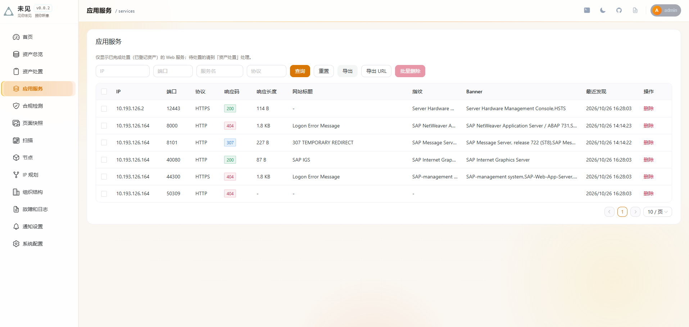
1. 对已处置的web服务进行展示和编辑操作。

### 合规检测
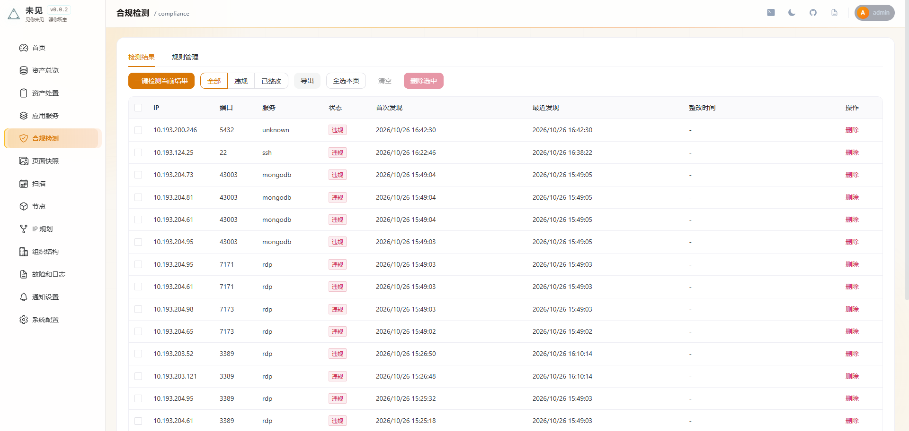
1. 对扫描中发现的可直连的数据库，ssh等进行展示，同时可以一键复测。
2. 可以自定义规则。

### 扫描
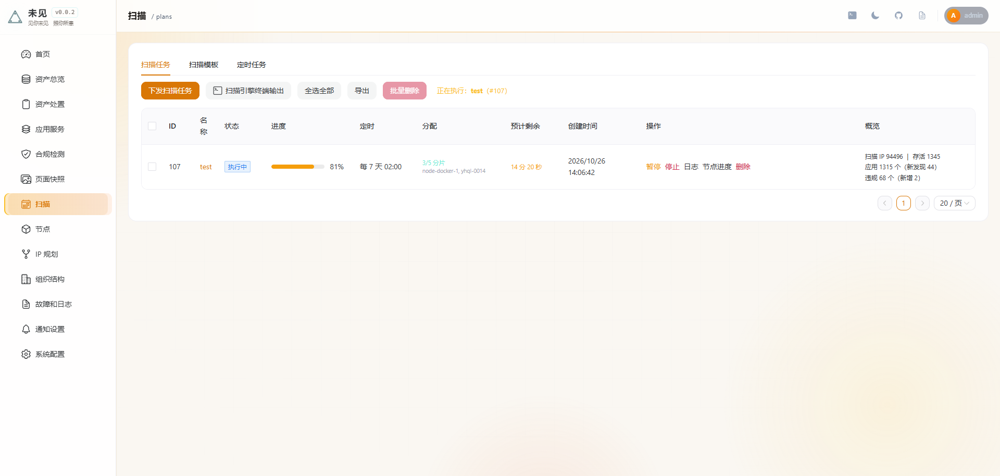
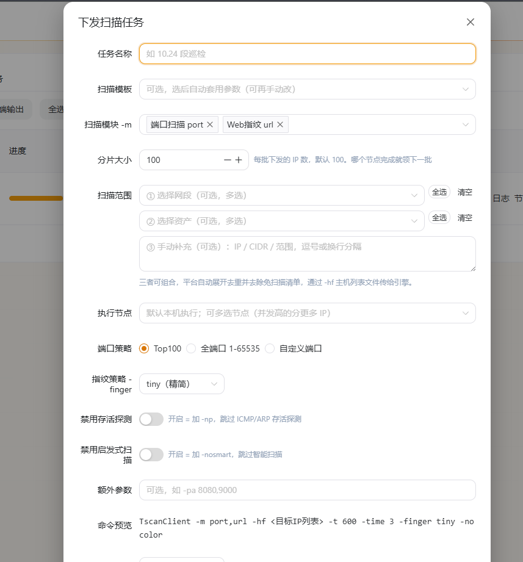
1. 下发任务，可以选择节点和配置各项参数，任务成果会在最右侧显示，显示结果随每次任务刷新。
2. 鉴于目前tscanclient的存活探测功能失效，服务端采用了icmp+tcp的方式先判定存活探测，在探测过程中，依据设定的分片数动态给子节点下发任务，如果暂停再继续，存活探测可以断点续传，下发的没有完成的分片会重新下发。
3. 可以编辑扫描策略模板。
4. 可以设定定时任务，定时任务子页面可以看到每一次定时任务的详情。
5. 扫描任务中可以便捷的设置各类参数。

### 节点
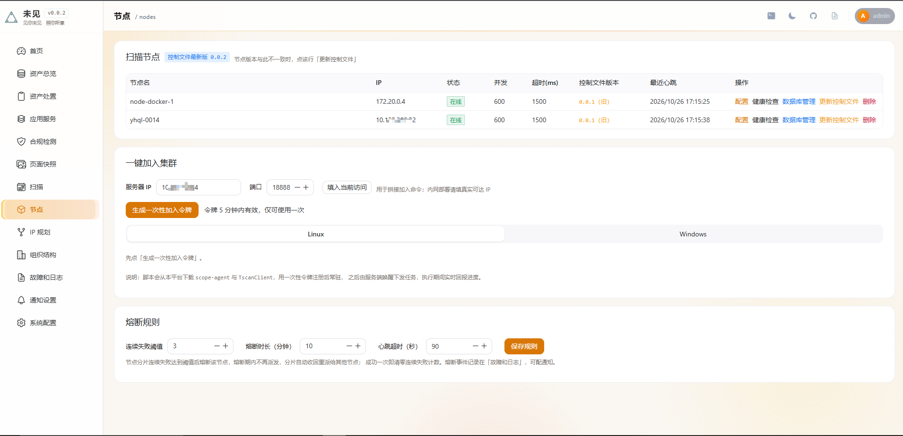
1. 一键加入集群，兼容linux和windows，可以选择单独下载控制文件或者完整下载（包含引擎），仅有控制文件无法完成扫描。
2. 根据节点性能可以设置每一个节点的并发。
3. 可以对子节点数据库进行管理，节约存储。
4. 可以设置熔断规则，对于连续失败的节点会熔断，规定时间内不再下发任务。
### IP规划
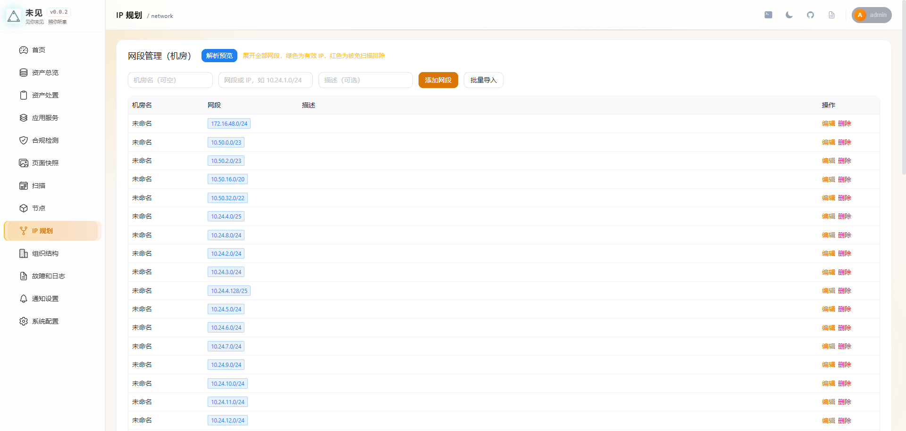
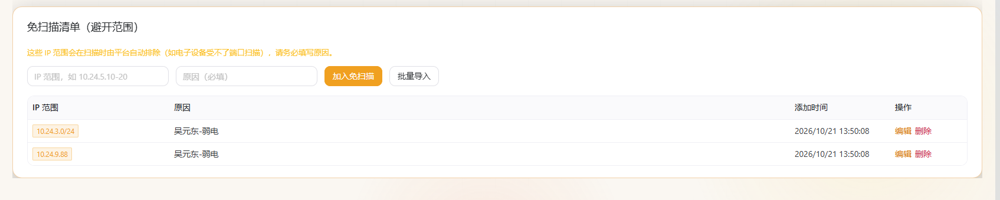
1. 预先导入一些内网段，扫描时一键选中。
2. 预先设置一些免扫描范围，扫描时自动排除。

### 组织结构
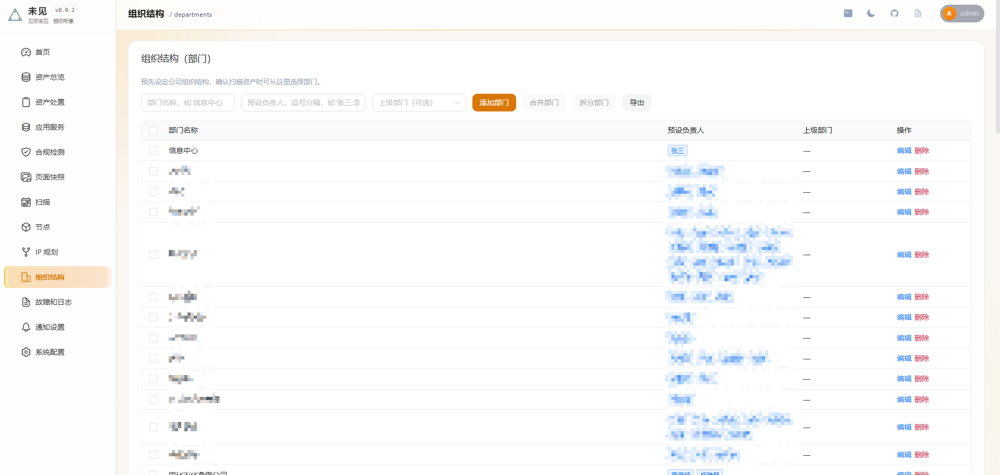
1. 可以合并拆分组织，可以编辑组室内负责人。

### 故障和日志
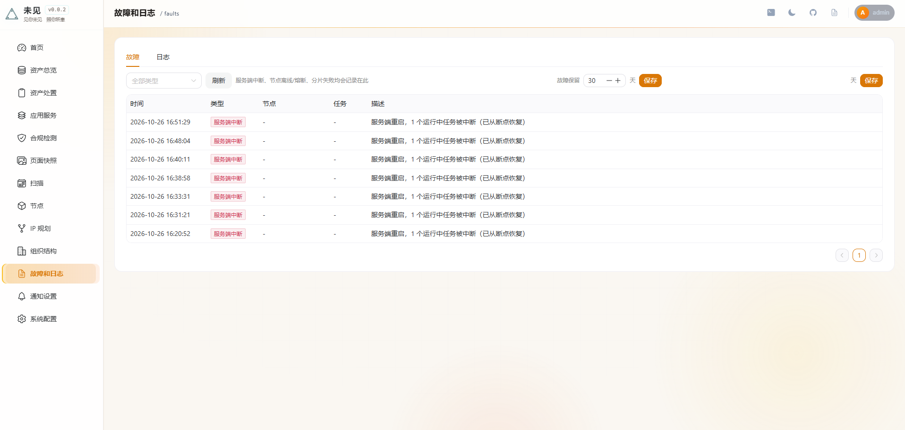
1. 显示故障和日志。

### 通知
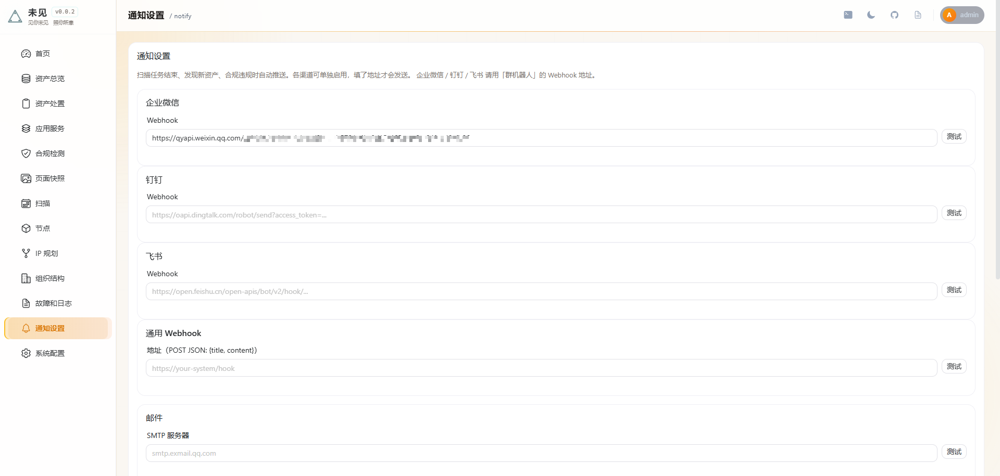
1. 可以通知，支持大多数常用的软件。

### 系统配置
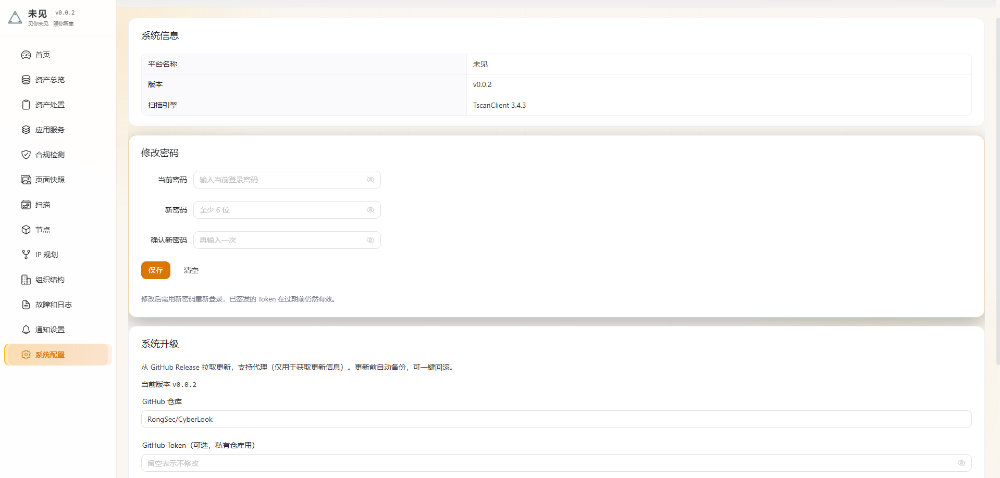
1. 一键升级，支持回滚。
2. 可以修改密码。

## 端口说明

| 端口 | 用途 |
|---|---|
| **18888** | Web 界面 + API（默认，可改） |
| 5432 | PostgreSQL（内部） |
| 6379 | Redis（内部） |

**修改端口**：系统配置 → 服务端口 → 保存 → 重启

## 故障排查

**问题：服务访问不到**
```bash
docker compose ps                    # 查看容器状态
docker compose logs server           # 查看日志
docker compose restart server        # 重启
```

**问题：节点离线**
```bash
# 检查 agent 日志
tail -f /opt/dongruo-agent/agent.log

# 重新加入
bash install.sh amd64
```

**问题：更新后二进制丢失**
```bash
# docker cp 的二进制会被容器重建丢弃，正确顺序：
docker cp asset-server-linux asset-server:/app/asset-server
docker compose restart server        # 不要用 up -d
```

## 版本记录

### v0.0.2（2026-10-26）

**扫描**
- 断点续传：探测进度 + 待扫池文件落盘，重启自动恢复
- 任务控制拆分：停止 / 暂停 / 继续 / 重跑
- 持续存活探测：不再等端口扫描消耗，池子持续积累
- 节点熔断：连续失败阈值触发，自动退避 + 分片重派

**资产**
- 修复处置后不从列表消失（`category=new` 未检查已确认状态）
- 修复处置后资产不出现在总览/应用服务（确认时自动创建 assets 记录）
- 首页「Web 资产」改为服务条数统计，与服务页口径统一
- 任务概览改为「本次执行」时间窗口，不再跨多次执行叠加

**组织**
- 从资产同步组织架构，支持一个部门多个负责人（逗号/顿号/分号/斜杠分隔）
- 部门编辑、合并、拆分
- 部门/负责人新建按钮（处置弹窗内）

**监控**
- 新增「故障和日志」页
- 故障记录保留期可配（默认 30 天，每日 03:00 清理）
- 服务端重启仅在中断运行中任务时记录，正常重启不产生噪音

**通知**
- 修复 webhook 失败被静默吞掉（现在解析 errcode/code，返回真实错误）
- 新增「故障告警」开关

**安全**
- 修复 `AgentTaskAuth` 未携带 token 时放行的问题（默认拒绝）
- 修复截图路径遍历、页面图片路径遍历
- 故障记录范围收窄，避免误报

### v0.0.1（初始版本）

- 分布式端口/Web 扫描、资产台账、处置、合规检测、页面快照、定时任务、通知、在线升级

## 许可证

MIT License — 详见 [LICENSE](LICENSE)


**使用前请遵守**：
- 不得用于非法用途
- 扫描目标需获得授权
- 遵守当地法律法规
